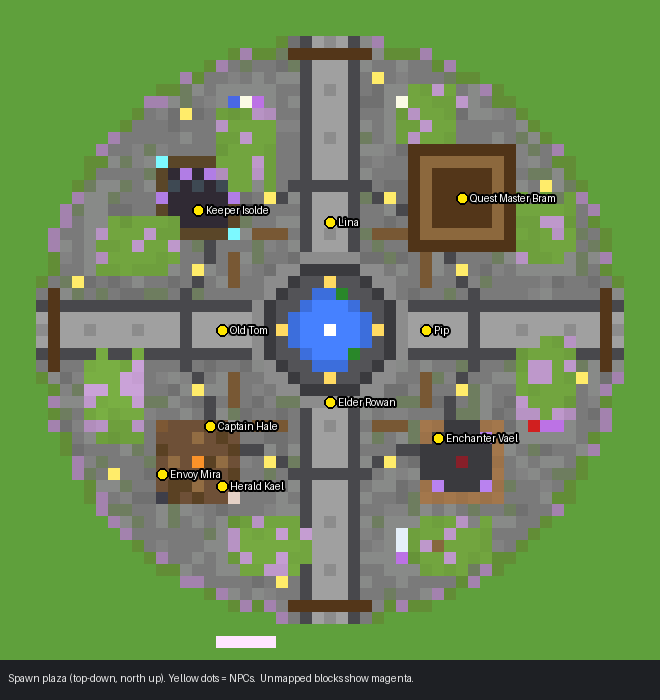
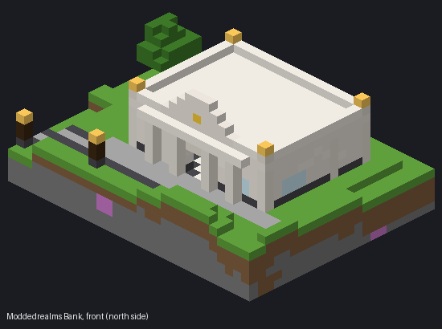

# ModdedrealmsSMP

NPC-driven survival for Bedwars201 ("Bedwars2"): quest givers with dialogue, a 10-chapter story, daily and weekly
quests with streaks, crates with virtual keys, playtime rewards, a first-join welcome, a generated spawn plaza, and a
living town around spawn with police, townsfolk, reputation and a jail.
Built to tie together what the server already has: ColonySMP colonies, MythicDepths bosses and `/warp`.



## NPCs

NPCs are vanilla Mannequins (player-shaped, can wear any skin). `npcs.yml` is the source of truth; they're
respawned whenever their chunk loads, look at nearby players and can stroll around (`wander`).
Clicking one plays its dialogue from `dialogues.yml` (lines appear one by one, then clickable choices), or the
next chapter of the player's story if this NPC gives it.

`/mrnpc list|create <id> [name]|move|skin <id> <account>|name|title|action|equip|wander <id> <r>|look|remove|tp`
(`mrsmp.admin`). `equip` copies your own armour and hands onto the NPC.

## Quests

`/quests` opens the quest menu, `/quests story` shows the current chapter. Defined in `quests.yml`:

- **Daily**: 3 random from 24 each day. Finishing all of them grows a streak (bonus keys at 3, 7, 14 days).
- **Weekly**: 2 random from 10 each week.
- **Story**: 10 chapters given by the plaza NPCs: crafting, `/warp`, the colonies, iron, enchanting, monsters,
  the Herald's warning, a first MythicDepths boss, and finally five bosses.

Objective types: BREAK, PLACE, HARVEST, KILL (types or HOSTILE/ANIMAL), KILL_BOSS (MythicDepths, credited to everyone
within 48 blocks), FISH, BREED, TAME, ENCHANT, EAT, CRAFT, SMELT, TRADE, COLONY_MEET (ColonySMP citizens), WALK,
PLAYTIME, COMMAND, TALK. Rewards: `money:<n>` (Essentials), `key:<crate>:<n>`, `xp:<n>`, `item:<MATERIAL>:<n>`,
`cmd:<console command with {player}>`.

Admin: `/quests reset <player>`, `/quests complete <player> <quest id|story>`.

## Crates

`/crates` (or Keeper Isolde, or the vaults at the Crate Shrine: right-click to open, left-click to preview).
Common, Rare, Mythic and Colony crates in `crates.yml` with weighted rewards; opening plays a slowing reel. Keys are
virtual (stored per player, can't be dropped, lost or duped). Keys come from quests, streaks, every hour online,
and every MythicDepths boss kill (`boss-kill-rewards`). Admin: `/mrsmp key <give|take|check> <player> <crate> [n]`.

## Spawn plaza

`/mrsmp spawn build [x floorY z [world]]` builds a 49-block round plaza centred on you: tiered fountain, four
avenues with gateways, hedge ring with lamp posts, benches, flowering azalea trees, and four stations with
floating signs and NPCs: Quest Pavilion, Crate Shrine, Arcane Corner (enchanting) and Adventurers' Camp
(bosses, colonies, `/warp`). Elder Rowan stands by the fountain and starts the story.
`/mrsmp spawn check x floorY z [world]` first lists what the plaza would replace (block entities, player-made
blocks, entities, how uneven the ground is) without changing anything.

Before building, the whole area is saved as a structure snapshot (`plaza-undo.nbt`): blocks **with their contents**
(chests, signs, command blocks, banners) and loose entities (item frames, armour stands, paintings). Then:
- underground blocks are only filled where there is air, so things buried under spawn (command blocks) are untouched;
- beacons under the floor keep their beams (the glass above them stays, the air above is cleared);
- mobs that end up inside a new block are lifted out; living mobs are never removed or duplicated.

`/mrsmp spawn undo` clears the plaza silently (no dropped lanterns or flowers) and puts the snapshot back exactly.
The used snapshot is kept as `plaza-undone-<time>.nbt`. One plaza at a time.

On Bedwars201 the plaza is centred on `world -394 70 463`, so the existing spawn point (-393.5 71 475.5) sits on
the south avenue facing the fountain and Elder Rowan.

## The town: police, townsfolk, reputation and the jail


Everything is in `config.yml` under `town:`. The centre is the plaza fountain (`-394, 463` on Bedwars201).

**Townsfolk** wander within 160 blocks of the fountain, a few around each player (fewer at night):
- *Travelling merchants* bring 5 random deals from `merchant-offers` (prices depend on your reputation; outlaws are refused).
- *Gossips* talk about what really happened: arrests, who is wanted, boss kills, caught thieves, plus hints.
- *Weary travellers* ask for food. Feeding one raises your reputation and sometimes gives coins or a key.
- *Pickpockets* look like everyone else until they bump into you and run (only coins: 3%, max $150, never items,
  never players with under 30 min playtime, once per 30 min per player). Hit them to get the money back plus a reward.
- *The Fence* appears at night for rogues and outlaws: buys stolen goods, sells a disguise (clears wanted stars when no
  officer is watching) and Black Market crate keys.

Players can pickpocket townsfolk (sneak + right-click with an empty hand, best from behind; coins and sometimes stolen
trinkets for the Fence) and rob other players (same move: 5% of their money, max $500, 20 min protection afterwards).

**Police** (the Town Watch) appear near players within 500 blocks of the fountain, behind them and out of sight,
2 per player plus backup for wanted players. They only react to what someone saw:

| Crime | Wanted | Notes |
|---|---|---|
| Carrying TNT, TNT minecarts, end crystals (visible in hand) | search | confiscated; first time is a warning, then a $50 fine |
| Pickpocketing / attacking a townsperson or villager | ★ | |
| Resisting arrest | +★ | running from an arrest order, or 10s without surrendering |
| Assault, robbing a player, arson, explosives, killing a pet | ★★ | fire/lava only counts next to things that burn |
| Assaulting an officer | ★★ | officers use force straight away |
| Killing a townsperson | ★★★ | |
| Murder | ★★★★ | |
| Killing an officer | ★★★★★ | |

- An officer who sees it makes you wanted at once; a townsperson or plaza NPC shouts for the police a moment later.
  Crimes nobody sees go unnoticed (but still cost reputation).
- Up to ★★ officers walk up and order you to surrender (crouch, or click [Surrender]); from ★★★, or if you resist,
  they draw swords. The hit that would kill you arrests you instead ("busted", +1 min).
- Not crimes: hitting back within 10s (self-defence), fighting someone who is wanted, anything WorldGuard blocked.
- Stars fade one per minute when no officer can see you. Leaving the 500-block zone stops the chase.
- Arrest: fine ($100 per star, never below $0), 1 min per star in a cell (max 5, only counts down while online),
  `/bail` to pay $4 per second left. Prisoners can't use other commands, teleport, fight or be hurt. Every arrest saves a
  ModdedrealmsGuard replay ("bodycam") so staff can check complaints.

**Reputation** (`/rep`): Outlaw ≤ -300 < Rogue ≤ -50 < Citizen < 100 ≤ Respected < 300 ≤ Hero. Quests, boss kills,
catching thieves and bandits, feeding travellers and community service raise it; crimes lower it. Heroes get 20% off
and are saluted. Officers also fight hostile mobs and bandits they see (not MythicDepths bosses).

**Bounties** (`/bounties`). Every wanted player carries $250 per star, and players can add their own money with
`/bounty <player> <amount>`. Bring a wanted player down yourself and the blow that would kill them is a **citizen's
arrest**: they go to jail and you get the whole bounty (anywhere within 2000 blocks of spawn). Or `/tip <player>` when
you can see them: the watch (inside 500 blocks) or the Bureau (further out) goes after them, and you get 50% if they're
caught within 10 minutes. `/tip` on its own reports the bandit you're looking at.

**Player police** (`/police`). Respected players sign up with Chief Warden Holt at the station and get a uniform. On duty
they hear the radio when someone becomes wanted, `/police radar` points to wanted players, sneak + right-click cuffs a
wanted player at ★★ or below (or anyone under 40% health), and beating one down arrests them. Pay: $75 per star per
arrest plus $50 every 10 minutes on duty in town, x1.25 per rank (Cadet, Officer at 5 arrests, Sergeant 15, Captain 30,
Chief 50). Breaking the law gets them dismissed. `/deputy` still works as an alias.

**Bribes.** An officer telling you to surrender also offers `[Bribe $300 per star]` (`/bribe`). 30% of officers take
it and forget everything; the rest add a charge for attempted bribery and use force. The Bureau never takes bribes.

**Bandits** roam the wilds 170-1500 blocks from the fountain (more at night, up to 8): 1-4 stars, $200 per star. They
attack anyone close and grab coins with each hit, run when they're losing, and surrender when beaten: you get the
bounty and everyone gets their coins back.

**The Bureau** takes over at 3 stars: a case stays open for 3 Minecraft days (new crimes extend it) and agents follow you
anywhere within 2000 blocks of spawn: random ambushes every 4-8 minutes, a stakeout at your bed, and a snare where you
keep coming back to. Arrest by the Bureau means the maximum sentence and closes the case; beyond 2000 blocks you're safe.
They also hunt 3-star bandits.

**Community service.** For a minute after an arrest (up to ★★★) prisoners can click `[Community service]` (`/service`)
and pick up glowing litter around the plaza instead (one piece per 12 seconds of sentence, only they see it). Walking
more than 50 blocks from the fountain sends them back to jail with 50% extra time.

**Stolen goods** (pickpocketed trinkets, bank gold) are evidence: an officer who searches you and finds them takes them
and makes you wanted for theft. Only the Fence buys them.

**The Golden Rat** (underground casino). `/mrtown casino build <x> <hallFloorY> <z>` digs it out at least 10 blocks under
the surface: a ruined shack hides a ladder down to the hall, and an emergency tunnel comes up in some bushes 36 blocks
south. Inside: 9 slot machines ($50 and $250; three of a kind pays 5x to 250x, a pair gives your stake back, about 96%
return), two blackjack tables with dealers (3:2, dealer stands on 17, double down), roulette with a shared spin every
30 seconds (red/black/odd/even/low/high 1:1, zero 35:1), dice against the house or `/dice <player> <stake>` (5% house cut),
a bar, NPC gamblers, and the Planner's back room. On Bedwars201 it's at `-350 50 850`, about 390 blocks south.
Gambling isn't a crime, being there during a **raid** is: every 8-20 minutes while players are inside, the Town Watch
storms in. Everyone inside gets a wanted star, half the NPC patrons run for the exits and the rest fight the officers,
who turn on whoever hits them. That's your chance to get out.


**Gangs** (`/gang`, gang chat `/gc`). $5,000 to found; leader, officers and members (10, 14 with the Crew perk).
10% of members' crime income goes into the gang bank automatically; turf pays $25 per chunk every hour while a member is
online. Perks bought from the bank: Bribes (+15% bribe success), Safecracker (vaults and drills 30% faster), Fence (+20%),
Lookouts (15s warning before casino raids, stars fade 25% faster), Crew (+4 slots). Claim chunks at least 200 blocks from
the fountain ($1,000 each, 2 + 2 per gang level), set a hideout there and `/gang hideout` to it (not while wanted).
Wars ($2,000): fighting and killing rival members isn't a crime, kills are tallied, and a rival who stands in one of your
chunks for 60 seconds with none of your members in it takes the chunk. `/gang peace` from both sides ends it.

**NPC gangs.** The Crimson Vipers and the Iron Jackals roam the wilds 220-1500 blocks out in groups of 3-4, fight each
other on sight, and attack players who aren't their friends. Taking one down pays $100, costs 10 standing with that
gang and gains 5 with their rivals; at 50 you're an ally: they leave you alone and help when someone attacks you. Each
gang has 25 strength: bring it to zero and it's wiped out for 48 hours, and whoever took down the most collects $5,000.

**Heists** (planned with the Planner, `/heist`, one at a time, crew of 2-4, $1,000 for equipment):
- *The Deep Vault*: cut the alarm behind the bank (20s at the red sparks without an officer seeing you; skip it and the
  police come at once, otherwise a minute after you start), drill the vault (120 crew-seconds), then carry 3 loot bags
  each ($2,500 apiece) to a getaway spot 560-720 blocks out. 6-hour cooldown.
- *The Armored Wagon*: once a crew member is near the bank, a treasury courier walks to the police station with 3
  officers. Bring it down (60 HP) for 2 bags each ($2,000 apiece). 3-hour cooldown.
Everyone involved goes to 5 stars (Bureau case). Loot bags slow you down; arrested, they're evidence; leftover bags sell
to the Fence for half.

**Prison breaks.** Bolt cutters ($1,500 from the Planner or the Fence) on a cell's barred window from outside the station:
20 seconds next to the wall, the alarm goes off at once (3 stars and a Bureau case) and the police come. Then the wall
under the window opens for 40 seconds; prisoners in that cell who get 8 blocks out have escaped (3 stars too).

**The bank.** `/mrtown bank build <x> <floorY> <z>` generates the Moddedrealms Bank (quartz portico, teller counter
with Banker Ellis, iron vault door, gold room, path to the plaza's south gate), saved first and reversible with
`/mrtown bank undo`. Right-clicking the vault starts a robbery (needs 2 players online): a server-wide alarm, every
robber wanted at ★★★★ (so the Bureau opens a case), police rushing in. Robbers have to stay within 5 blocks of the vault
for 60 robber-seconds (2 robbers: 30s, 3+: 20s); then $4,000-9,000 is split and each gets 2 gold bars worth $400 to the
Fence. Once every 3 hours. Bank and jail paths share the plaza's south gate: undo them in reverse order of building.



**The jail.** `/mrtown jail build <x> <floorY> <z>` generates a police station (front door facing north, office with
Chief Warden Holt and a live WANTED board, 4 cells, a watchtower with a blue light, and a path to the plaza's south
gate). Like the plaza, the area is saved first and `/mrtown jail undo` puts it back exactly; `/mrtown jail check` lists
what would be replaced. To use your own building instead: stand in each cell and `/mrtown jail addcell`, then
`/mrtown jail setrelease` outside. Without cells, arrests only fine.

Player commands: `/rep`, `/wanted`, `/bounties`, `/bounty`, `/tip`, `/bail`, `/service`, `/surrender`, `/bribe`,
`/police [join|duty|radar|cuff|quit]`. Admin (`mrsmp.admin`): `/mrtown status | toggle | clear | spawn <role> [stars] |
wanted <player> <stars> | pardon | release | arrest | rep <player> [set|add n] | case <player> [close|ambush] |
service <player> | jail ... | bank ... | casino ... | raid | npcgang <vipers|jackals> | heists`.
More player commands: `/gang`, `/gc`, `/heist`, `/dice`.
Staff who build or test near spawn can be given `mrsmp.lawless` so the police ignore them.

How the NPCs walk: each one is an invisible, silent skeleton with its AI removed (it only pathfinds where told) carrying
a Mannequin with the clothes. Neither is saved with the world. Needs a difficulty above peaceful.

## Console bridge

AMP has no command-line way to type into the console, so lines appended to
`plugins/ModdedrealmsSMP/console.in` are run as console commands once a second (`console-bridge` in config.yml).
Only someone who can already write the server's files can use it.

## Build

```bash
~/.local/share/apache-maven-3.9.9/bin/mvn -f minecraft-smp/pom.xml package
```
