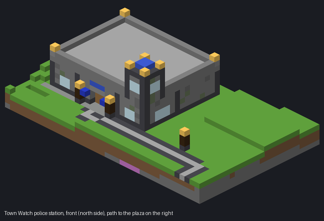

# ModdedrealmsSMP

NPC-driven survival for Bedwars201 ("Bedwars2"): quest givers with dialogue, a 10-chapter story, daily and weekly
quests with streaks, crates with virtual keys, playtime rewards, a first-join welcome, a generated spawn plaza, and a
living town around spawn with police, townsfolk, reputation and a jail.
Built to tie together what the server already has: ColonySMP colonies, MythicDepths bosses and `/warp`.


## NPCs

NPCs are vanilla Mannequins (player-shaped, can wear any skin). `npcs.yml` is the source of truth; they're
respawned whenever their chunk loads, look at nearby players and can stroll around (`wander`).
Clicking one plays its dialogue from `dialogues.yml` (lines appear one by one, then clickable choices), or the
next chapter of the player's story if this NPC gives it.

`/mrnpc list|create <id> [name]|move|skin <id> <account>|name|title|action|equip|wander <id> <r>|look|remove|tp`
(`mrsmp.admin`). `equip` copies your own armour and hands onto the NPC.

## Quests

`/quests` opens the quest menu, `/quests story` shows the current chapter. Defined in `quests.yml`:

- **Daily**: 3 random from 24 each day. Finishing all of them grows a streak (bonus keys at 3, 7, 14 days).
- **Weekly**: 2 random from 10 each week.
- **Story**: 10 chapters given by the plaza NPCs: crafting, `/warp`, the colonies, iron, enchanting, monsters,
  the Herald's warning, a first MythicDepths boss, and finally five bosses.

Objective types: BREAK, PLACE, HARVEST, KILL (types or HOSTILE/ANIMAL), KILL_BOSS (MythicDepths, credited to everyone
within 48 blocks), FISH, BREED, TAME, ENCHANT, EAT, CRAFT, SMELT, TRADE, COLONY_MEET (ColonySMP citizens), WALK,
PLAYTIME, COMMAND, TALK. Rewards: `money:<n>` (Essentials), `key:<crate>:<n>`, `xp:<n>`, `item:<MATERIAL>:<n>`,
`cmd:<console command with {player}>`.

Admin: `/quests reset <player>`, `/quests complete <player> <quest id|story>`.

## Crates

`/crates` (or Keeper Isolde, or the vaults at the Crate Shrine: right-click to open, left-click to preview).
Common, Rare, Mythic and Colony crates in `crates.yml` with weighted rewards; opening plays a slowing reel. Keys are
virtual (stored per player, can't be dropped, lost or duped). Keys come from quests, streaks, every hour online,
and every MythicDepths boss kill (`boss-kill-rewards`). Admin: `/mrsmp key <give|take|check> <player> <crate> [n]`.

## Spawn plaza

`/mrsmp spawn build [x floorY z [world]]` builds a 49-block round plaza centred on you: tiered fountain, four
avenues with gateways, hedge ring with lamp posts, benches, flowering azalea trees, and four stations with
floating signs and NPCs: Quest Pavilion, Crate Shrine, Arcane Corner (enchanting) and Adventurers' Camp
(bosses, colonies, `/warp`). Elder Rowan stands by the fountain and starts the story.
`/mrsmp spawn check x floorY z [world]` first lists what the plaza would replace (block entities, player-made
blocks, entities, how uneven the ground is) without changing anything.

Before building, the whole area is saved as a structure snapshot (`plaza-undo.nbt`): blocks **with their contents**
(chests, signs, command blocks, banners) and loose entities (item frames, armour stands, paintings). Then:
- underground blocks are only filled where there is air, so things buried under spawn (command blocks) are untouched;
- beacons under the floor keep their beams (the glass above them stays, the air above is cleared);
- mobs that end up inside a new block are lifted out; living mobs are never removed or duplicated.

`/mrsmp spawn undo` clears the plaza silently (no dropped lanterns or flowers) and puts the snapshot back exactly.
The used snapshot is kept as `plaza-undone-<time>.nbt`. One plaza at a time.

On Bedwars201 the plaza is centred on `world -394 70 463`, so the existing spawn point (-393.5 71 475.5) sits on
the south avenue facing the fountain and Elder Rowan.

## The town: police, townsfolk, reputation and the jail



Everything is in `config.yml` under `town:`. The centre is the plaza fountain (`-394, 463` on Bedwars201).

**Townsfolk** wander within 160 blocks of the fountain, a few around each player (fewer at night):
- *Travelling merchants* bring 5 random deals from `merchant-offers` (prices depend on your reputation; outlaws are refused).
- *Gossips* talk about what really happened: arrests, who is wanted, boss kills, caught thieves, plus hints.
- *Weary travellers* ask for food. Feeding one raises your reputation and sometimes gives coins or a key.
- *Pickpockets* look like everyone else until they bump into you and run (only coins: 3%, max $150, never items,
  never players with under 30 min playtime, once per 30 min per player). Hit them to get the money back plus a reward.
- *The Fence* appears at night for rogues and outlaws: buys stolen goods, sells a disguise (clears wanted stars when no
  officer is watching) and Black Market crate keys.

Players can pickpocket townsfolk (sneak + right-click with an empty hand, best from behind; coins and sometimes stolen
trinkets for the Fence) and rob other players (same move: 5% of their money, max $500, 20 min protection afterwards).

**Police** (the Town Watch) appear near players within 500 blocks of the fountain, behind them and out of sight,
2 per player plus backup for wanted players. They only react to what someone saw:

| Crime | Wanted | Notes |
|---|---|---|
| Carrying TNT, TNT minecarts, end crystals (visible in hand) | search | confiscated; first time is a warning, then a $50 fine |
| Pickpocketing / attacking a townsperson or villager | ★ | |
| Resisting arrest | +★ | running from an arrest order, or 10s without surrendering |
| Assault, robbing a player, arson, explosives, killing a pet | ★★ | fire/lava only counts next to things that burn |
| Assaulting an officer | ★★ | officers use force straight away |
| Killing a townsperson | ★★★ | |
| Murder | ★★★★ | |
| Killing an officer | ★★★★★ | |

- An officer who sees it makes you wanted at once; a townsperson or plaza NPC shouts for the police a moment later.
  Crimes nobody sees go unnoticed (but still cost reputation).
- Up to ★★ officers walk up and order you to surrender (crouch, or click [Surrender]); from ★★★, or if you resist,
  they draw swords. The hit that would kill you arrests you instead ("busted", +1 min).
- Not crimes: hitting back within 10s (self-defence), fighting someone who is wanted, anything WorldGuard blocked.
- Stars fade one per minute when no officer can see you. Leaving the 500-block zone stops the chase.
- Arrest: fine ($100 per star, never below $0), 1 min per star in a cell (max 5, only counts down while online),
  `/bail` to pay $4 per second left. Prisoners can't use other commands, teleport, fight or be hurt. Every arrest saves a
  ModdedrealmsGuard replay ("bodycam") so staff can check complaints.

**Reputation** (`/rep`): Outlaw ≤ -300 < Rogue ≤ -50 < Citizen < 100 ≤ Respected < 300 ≤ Hero. Quests, boss kills,
catching thieves and feeding travellers raise it; crimes lower it. Heroes get 20% off and are saluted; respected players
can become deputies (`/deputy`): told about wanted players, paid $75 per star for every wanted player they helped bring
in, and their killing blow on a wanted player arrests instead. Breaking the law takes the badge away.

**The jail.** `/mrtown jail build <x> <floorY> <z>` generates a police station (front door facing north, office with
Chief Warden Holt and a live WANTED board, 4 cells, a watchtower with a blue light, and a path to the plaza's south
gate). Like the plaza, the area is saved first and `/mrtown jail undo` puts it back exactly; `/mrtown jail check` lists
what would be replaced. To use your own building instead: stand in each cell and `/mrtown jail addcell`, then
`/mrtown jail setrelease` outside. Without cells, arrests only fine.

Player commands: `/rep`, `/wanted`, `/bail`, `/surrender`, `/deputy`. Admin (`mrsmp.admin`): `/mrtown status | toggle |
clear | spawn <role> | wanted <player> <stars> | pardon | release | arrest | rep <player> [set|add n] | jail ...`.
Staff who build or test near spawn can be given `mrsmp.lawless` so the police ignore them.

How the NPCs walk: each one is an invisible, silent skeleton with its AI removed (it only pathfinds where told) carrying
a Mannequin with the clothes. Neither is saved with the world. Needs a difficulty above peaceful.

## Console bridge

AMP has no command-line way to type into the console, so lines appended to
`plugins/ModdedrealmsSMP/console.in` are run as console commands once a second (`console-bridge` in config.yml).
Only someone who can already write the server's files can use it.

## Build

```bash
~/.local/share/apache-maven-3.9.9/bin/mvn -f minecraft-smp/pom.xml package
```
