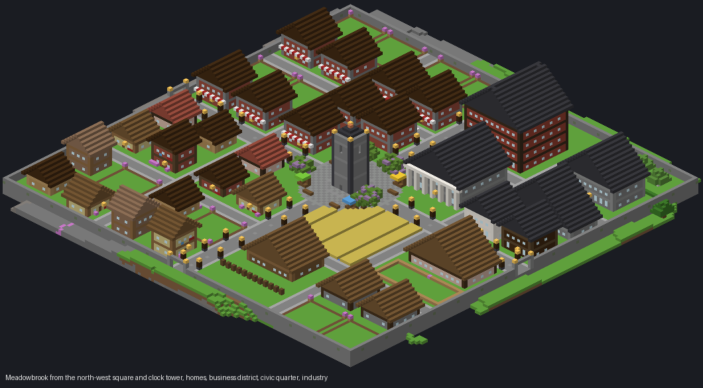
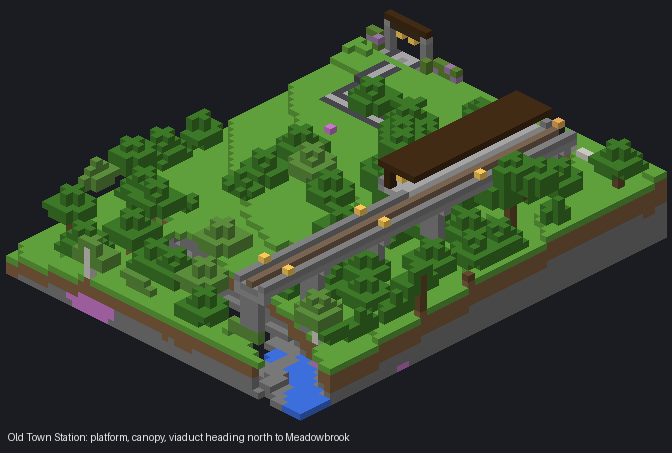
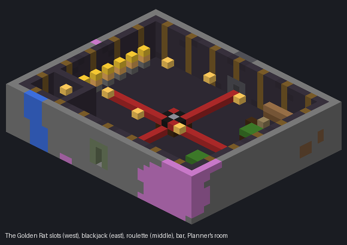
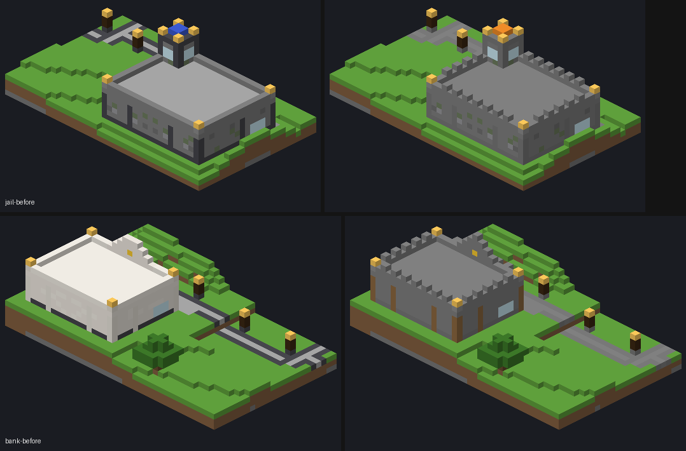
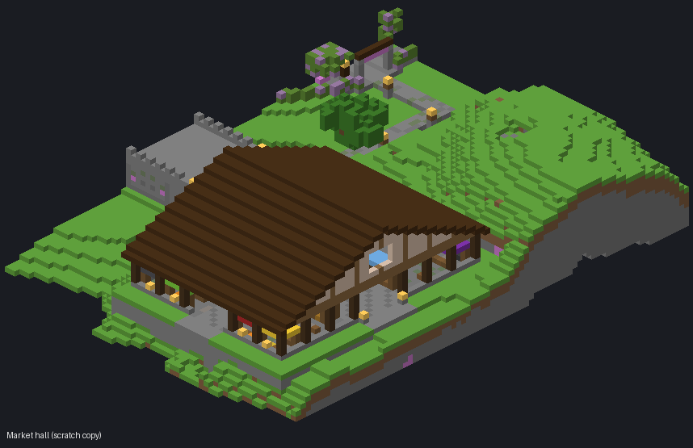
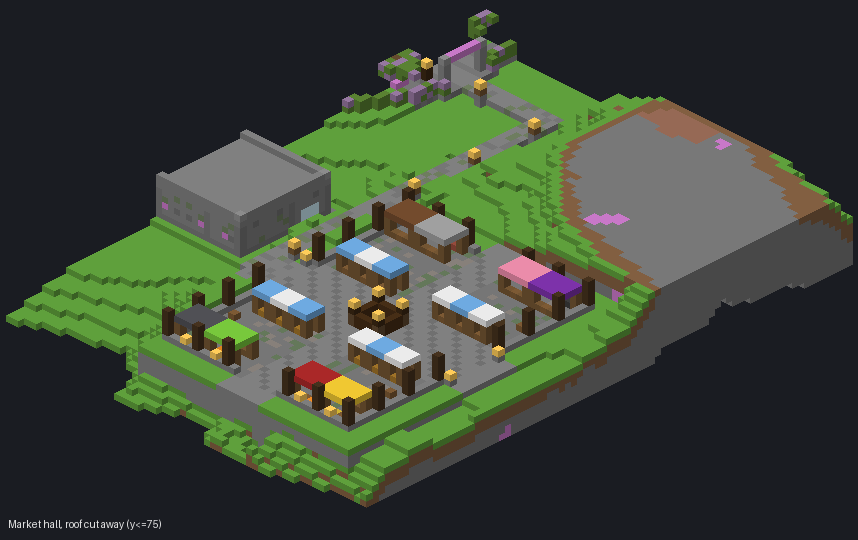

# ModdedrealmsSMP

NPC-driven survival for Bedwars201 ("Bedwars2"): quest givers with dialogue, a 10-chapter story, daily and weekly
quests with streaks, crates with virtual keys, playtime rewards, a first-join welcome, a generated spawn plaza, and a
living town around spawn with police, townsfolk, reputation and a jail.
Built to tie together what the server already has: ColonySMP colonies, MythicDepths bosses and `/warp`.


## NPCs

NPCs are vanilla Mannequins (player-shaped, can wear any skin). `npcs.yml` is the source of truth; they're
respawned whenever their chunk loads, look at nearby players and can stroll around (`wander`).
Clicking one plays its dialogue from `dialogues.yml` (lines appear one by one, then clickable choices), or the
next chapter of the player's story if this NPC gives it.

`/mrnpc list|create <id> [name]|move|skin <id> <account>|name|title|action|equip|wander <id> <r>|look|remove|tp`
(`mrsmp.admin`). `equip` copies your own armour and hands onto the NPC.

## Quests

`/quests` opens the quest menu, `/quests story` shows the current chapter. Defined in `quests.yml`:

- **Daily**: 3 random from 24 each day. Finishing all of them grows a streak (bonus keys at 3, 7, 14 days).
- **Weekly**: 2 random from 10 each week.
- **Story**: 10 chapters given by the plaza NPCs: crafting, `/warp`, the colonies, iron, enchanting, monsters,
  the Herald's warning, a first MythicDepths boss, and finally five bosses.

Objective types: BREAK, PLACE, HARVEST, KILL (types or HOSTILE/ANIMAL), KILL_BOSS (MythicDepths, credited to everyone
within 48 blocks), FISH, BREED, TAME, ENCHANT, EAT, CRAFT, SMELT, TRADE, COLONY_MEET (ColonySMP citizens), WALK,
PLAYTIME, COMMAND, TALK. Rewards: `money:<n>` (Essentials), `key:<crate>:<n>`, `xp:<n>`, `item:<MATERIAL>:<n>`,
`cmd:<console command with {player}>`.

Admin: `/quests reset <player>`, `/quests complete <player> <quest id|story>`.

## Crates

`/crates` (or Keeper Isolde, or the vaults at the Crate Shrine: right-click to open, left-click to preview).
Common, Rare, Mythic and Colony crates in `crates.yml` with weighted rewards; opening plays a slowing reel. Keys are
virtual (stored per player, can't be dropped, lost or duped). Keys come from quests, streaks, every hour online,
and every MythicDepths boss kill (`boss-kill-rewards`). Admin: `/mrsmp key <give|take|check> <player> <crate> [n]`.

## Spawn plaza

`/mrsmp spawn build [x floorY z [world]]` builds a 49-block round plaza centred on you: tiered fountain, four
avenues with gateways, hedge ring with lamp posts, benches, flowering azalea trees, and four stations with
floating signs and NPCs: Quest Pavilion, Crate Shrine, Arcane Corner (enchanting) and Adventurers' Camp
(bosses, colonies, `/warp`). Elder Rowan stands by the fountain and starts the story.
`/mrsmp spawn check x floorY z [world]` first lists what the plaza would replace (block entities, player-made
blocks, entities, how uneven the ground is) without changing anything.

Before building, the whole area is saved as a structure snapshot (`plaza-undo.nbt`): blocks **with their contents**
(chests, signs, command blocks, banners) and loose entities (item frames, armour stands, paintings). Then:
- underground blocks are only filled where there is air, so things buried under spawn (command blocks) are untouched;
- beacons under the floor keep their beams (the glass above them stays, the air above is cleared);
- mobs that end up inside a new block are lifted out; living mobs are never removed or duplicated.

`/mrsmp spawn undo` clears the plaza silently (no dropped lanterns or flowers) and puts the snapshot back exactly.
The used snapshot is kept as `plaza-undone-<time>.nbt`. One plaza at a time.

On Bedwars201 the plaza is centred on `world -394 70 463`, so the existing spawn point (-393.5 71 475.5) sits on
the south avenue facing the fountain and Elder Rowan.

## The town: police, townsfolk, reputation and the jail


Everything is in `config.yml` under `town:`. The centre is the plaza fountain (`-394, 463` on Bedwars201).

**Townsfolk** wander within 160 blocks of the fountain, a few around each player (fewer at night):
- *Travelling merchants* bring 5 random deals from `merchant-offers` (prices depend on your reputation; outlaws are refused).
- *Gossips* talk about what really happened: arrests, who is wanted, boss kills, caught thieves, plus hints.
- *Weary travellers* ask for food. Feeding one raises your reputation and sometimes gives coins or a key.
- *Pickpockets* look like everyone else until they bump into you and run (only coins: 3%, max $150, never items,
  never players with under 30 min playtime, once per 30 min per player). Hit them to get the money back plus a reward.
- *The Fence* appears at night for rogues and outlaws: buys stolen goods, sells a disguise (clears wanted stars when no
  officer is watching) and Black Market crate keys.

Players can pickpocket townsfolk (sneak + right-click with an empty hand, best from behind; coins and sometimes stolen
trinkets for the Fence) and rob other players (same move: 5% of their money, max $500, 20 min protection afterwards).

**Police** (the Town Watch) appear near players within 500 blocks of the fountain, behind them and out of sight,
2 per player plus backup for wanted players. They only react to what someone saw:

| Crime | Wanted | Notes |
|---|---|---|
| Carrying TNT, TNT minecarts, end crystals (visible in hand) | search | confiscated; first time is a warning, then a $50 fine |
| Pickpocketing / attacking a townsperson or villager | ★ | |
| Resisting arrest | +★ | running from an arrest order, or 10s without surrendering |
| Assault, robbing a player, arson, explosives, killing a pet | ★★ | fire/lava only counts next to things that burn |
| Assaulting an officer | ★★ | officers use force straight away |
| Killing a townsperson | ★★★ | |
| Murder | ★★★★ | |
| Killing an officer | ★★★★★ | |

- An officer who sees it makes you wanted at once; a townsperson or plaza NPC shouts for the police a moment later.
  Crimes nobody sees go unnoticed (but still cost reputation).
- Up to ★★ officers walk up and order you to surrender (crouch, or click [Surrender]); from ★★★, or if you resist,
  they draw swords. The hit that would kill you arrests you instead ("busted", +1 min).
- Not crimes: hitting back within 10s (self-defence), fighting someone who is wanted, anything WorldGuard blocked.
- Stars fade one per minute when no officer can see you. Leaving the 500-block zone stops the chase.
- Arrest: fine ($100 per star, never below $0), 1 min per star in a cell (max 5, only counts down while online),
  `/bail` to pay $4 per second left. Prisoners can't use other commands, teleport, fight or be hurt. Every arrest saves a
  ModdedrealmsGuard replay ("bodycam") so staff can check complaints.

**Reputation** (`/rep`): Outlaw ≤ -300 < Rogue ≤ -50 < Citizen < 100 ≤ Respected < 300 ≤ Hero. Quests, boss kills,
catching thieves and bandits, feeding travellers and community service raise it; crimes lower it. Heroes get 20% off
and are saluted. Officers also fight hostile mobs and bandits they see (not MythicDepths bosses).

**Bounties** (`/bounties`). Every wanted player carries $250 per star, and players can add their own money with
`/bounty <player> <amount>`. Bring a wanted player down yourself and the blow that would kill them is a **citizen's
arrest**: they go to jail and you get the whole bounty (anywhere within 2000 blocks of spawn). Or `/tip <player>` when
you can see them: the watch (inside 500 blocks) or the Bureau (further out) goes after them, and you get 50% if they're
caught within 10 minutes. `/tip` on its own reports the bandit you're looking at.

**Player police** (`/police`). Respected players sign up with Chief Warden Holt at the station and get a uniform. On duty
they hear the radio when someone becomes wanted, `/police radar` points to wanted players, sneak + right-click cuffs a
wanted player at ★★ or below (or anyone under 40% health), and beating one down arrests them. Pay: $75 per star per
arrest plus $50 every 10 minutes on duty in town, x1.25 per rank (Cadet, Officer at 5 arrests, Sergeant 15, Captain 30,
Chief 50). Breaking the law gets them dismissed. `/deputy` still works as an alias.

**Bribes.** An officer telling you to surrender also offers `[Bribe $300 per star]` (`/bribe`). 30% of officers take
it and forget everything; the rest add a charge for attempted bribery and use force. The Bureau never takes bribes.

**Bandits** roam the wilds 170-1500 blocks from the fountain (more at night, up to 8): 1-4 stars, $200 per star. They
attack anyone close and grab coins with each hit, run when they're losing, and surrender when beaten: you get the
bounty and everyone gets their coins back.

**The Bureau** takes over at 3 stars: a case stays open for 3 Minecraft days (new crimes extend it) and agents follow you
anywhere within 2000 blocks of spawn: random ambushes every 4-8 minutes, a stakeout at your bed, and a snare where you
keep coming back to. Arrest by the Bureau means the maximum sentence and closes the case; beyond 2000 blocks you're safe.
They also hunt 3-star bandits.

**Community service.** For a minute after an arrest (up to ★★★) prisoners can click `[Community service]` (`/service`)
and pick up glowing litter around the plaza instead (one piece per 12 seconds of sentence, only they see it). Walking
more than 50 blocks from the fountain sends them back to jail with 50% extra time.

**Stolen goods** (pickpocketed trinkets, bank gold) are evidence: an officer who searches you and finds them takes them
and makes you wanted for theft. Only the Fence buys them.

**Meadowbrook** (`/mrtown meadowbrook build <x> <floorY> <z>`), the market city on the northern island
(centre `-428 72 -662` on Bedwars201, about 1,110 blocks from spawn). The site is levelled and saved first (undo
restores it). A 129-block square town inside a stone wall with four gates: a clock-tower square with market stalls
and a land agent; a business district (15 plots: 3 town-run shops, built shops and bare plots); a residential quarter
(16 houses: family homes plus homes for sale); industry (wheat fields, the Wool Mill with its sheep, Brookside Lumber,
workshops); and the civic quarter (courthouse with judge's bench, jury box and gallery, the Herald, Savings & Loans,
the sheriff's office with 3 cells, the Grand Meadow Hotel, the town hall and a park). Meadowbrook is a town of its own:
its own police zone (200 blocks), townsfolk, and jail (arrests there go to its cells).



**Plots** (`/plot`): stand on one and `/plot buy` or `/plot rent` (rent is taken daily; miss a day and there's one
day of grace, then the plot goes back on the market). Owners can build on their plot and `/plot trust` friends;
everything else in a generated town is protected, containers included. `/plot list`, `/plot mine`, `/plot leave`
(bought plots sell back for half). Prices and rents are in `town.plots`; rent and sales go to the town treasury.

**The Meadowbrook Line** (`/mrtown railway build <x> <southZ> <northZ>`): a straight railway (x `-428`, z `430` to
`-594`) on a viaduct over land, through a tunnel and over a 490-block sea bridge, from Old Town Station (north-west of
the plaza, with stairs and a path to the plaza's north gate) to Meadowbrook Station at the south gate. One train
shuttles on a timetable (45 s boarding, about a minute's ride at 20 blocks/s); cars only exist while players are
around. Tickets from the station clerks (`/ticket`): single $200, return $350, day pass $600, and 60% off the first
ticket anyone buys. No getting off mid-sea; NPC passengers fill spare seats. Wanted players (3+ stars) can't buy one.



**The Golden Rat** (underground casino). `/mrtown casino build <x> <hallFloorY> <z>` digs it out at least 10 blocks under
the surface: a ruined shack hides a ladder down to the hall, and an emergency tunnel comes up in some bushes 36 blocks
south. Inside: 9 slot machines ($50 and $250; three of a kind pays 5x to 250x, a pair gives your stake back, about 96%
return), two blackjack tables with dealers (3:2, dealer stands on 17, double down), roulette with a shared spin every
30 seconds (red/black/odd/even/low/high 1:1, zero 35:1), dice against the house or `/dice <player> <stake>` (5% house cut),
a bar, NPC gamblers, and the Planner's back room. On Bedwars201 it's at `-350 50 850`, about 390 blocks south.
Gambling isn't a crime, being there during a **raid** is: every 8-20 minutes while players are inside, the Town Watch
storms in. Everyone inside gets a wanted star, half the NPC patrons run for the exits and the rest fight the officers,
who turn on whoever hits them. That's your chance to get out.



**Gangs** (`/gang`, gang chat `/gc`). $5,000 to found; leader, officers and members (10, 14 with the Crew perk).
10% of members' crime income goes into the gang bank automatically; turf pays $25 per chunk every hour while a member is
online. Perks bought from the bank: Bribes (+15% bribe success), Safecracker (vaults and drills 30% faster), Fence (+20%),
Lookouts (15s warning before casino raids, stars fade 25% faster), Crew (+4 slots). Claim chunks at least 200 blocks from
the fountain ($1,000 each, 2 + 2 per gang level), set a hideout there and `/gang hideout` to it (not while wanted).
Wars ($2,000): fighting and killing rival members isn't a crime, kills are tallied, and a rival who stands in one of your
chunks for 60 seconds with none of your members in it takes the chunk. `/gang peace` from both sides ends it.

**NPC gangs.** The Crimson Vipers and the Iron Jackals roam the wilds 220-1500 blocks out in groups of 3-4, fight each
other on sight, and attack players who aren't their friends. Taking one down pays $100, costs 10 standing with that
gang and gains 5 with their rivals; at 50 you're an ally: they leave you alone and help when someone attacks you. Each
gang has 25 strength: bring it to zero and it's wiped out for 48 hours, and whoever took down the most collects $5,000.

**Heists** (planned with the Planner, `/heist`, one at a time, crew of 2-4, $1,000 for equipment):
- *The Deep Vault*: cut the alarm behind the bank (20s at the red sparks without an officer seeing you; skip it and the
  police come at once, otherwise a minute after you start), drill the vault (120 crew-seconds), then carry 3 loot bags
  each ($2,500 apiece) to a getaway spot 560-720 blocks out. 6-hour cooldown.
- *The Armored Wagon*: once a crew member is near the bank, a treasury courier walks to the police station with 3
  officers. Bring it down (60 HP) for 2 bags each ($2,000 apiece). 3-hour cooldown.
Everyone involved goes to 5 stars (Bureau case). Loot bags slow you down; arrested, they're evidence; leftover bags sell
to the Fence for half.

**Prison breaks.** Bolt cutters ($1,500 from the Planner or the Fence) on a cell's barred window from outside the station:
20 seconds next to the wall, the alarm goes off at once (3 stars and a Bureau case) and the police come. Then the wall
under the window opens for 40 seconds; prisoners in that cell who get 8 blocks out have escaped (3 stars too).

**The bank.** `/mrtown bank build <x> <floorY> <z>` generates the Moddedrealms Bank (quartz portico, teller counter
with Banker Ellis, iron vault door, gold room, path to the plaza's south gate), saved first and reversible with
`/mrtown bank undo`. Right-clicking the vault starts a robbery (needs 2 players online): a server-wide alarm, every
robber wanted at ★★★★ (so the Bureau opens a case), police rushing in. Robbers have to stay within 5 blocks of the vault
for 60 robber-seconds (2 robbers: 30s, 3+: 20s); then $4,000-9,000 is split and each gets 2 gold bars worth $400 to the
Fence. Once every 3 hours. Bank and jail paths share the plaza's south gate: undo them in reverse order of building.


**The jail.** `/mrtown jail build <x> <floorY> <z>` generates a police station (front door facing north, office with
Chief Warden Holt and a live WANTED board, 4 cells, a watchtower with a blue light, and a path to the plaza's south
gate). Like the plaza, the area is saved first and `/mrtown jail undo` puts it back exactly; `/mrtown jail check` lists
what would be replaced. To use your own building instead: stand in each cell and `/mrtown jail addcell`, then
`/mrtown jail setrelease` outside. Without cells, arrests only fine.

**Businesses** (`/business`, alias `/biz`). Stand on a business or industry plot you own and
`/business start <type> <name>`: farm, wool mill, lumber mill, bakery, tavern, tailor, furniture workshop, restaurant,
general store, hotel, or a speakeasy (illegal). Every 5 minutes the economy runs a cycle:

1. The police check every player business. A fugitive owner (3★ or a Bureau case) gets it closed; a speakeasy can be
   raided (stock seized, 20% of its cash fined, closed for an hour); a bakery, restaurant or hotel with a rating under 1
   can fail a health inspection.
2. Each business makes its product from inputs it buys from the cheapest open supplier, or imports at double price
   when nobody has stock. The chain: farms → bakeries, taverns, restaurants; wool mill → tailors and furniture; lumber →
   furniture and stores; bread, cloth and beds → restaurants, stores and the hotel. A hotel needs beds, so it depends
   on the furniture workshop, which depends on the wool mill.
3. Townspeople buy bread, ale, meals, household goods, hotel stays and moonshine. Each seller's share depends on rating,
   price against the fair price, and stock. More players online means more demand.
4. Staff wages, upkeep, insurance and a 5% tax to the town treasury are paid, and the owner gets a report.

The town runs its own businesses on the same rules (Copper Kettle, General Store, Bramble Bakery, Wool Mill, Brookside
Lumber, Meadowbrook Farms, Grand Meadow Hotel, Rusty Tankard, Thistle & Thread, Oakheart Furniture). A player who
sells more than 40% of a good for 6 cycles in a row draws a **rival company**, which undercuts them. Big businesses and
markets with rivals get **sabotaged** more often: broken equipment, rumours, stolen stock or a fire. Security cuts the
odds, and insurance pays 80% of the loss. `/business` opens the panel (prices, upgrades, NPC staff, jobs and wage,
security, insurance); `/business market` shows every seller's price, stock and rating; `/business deposit|withdraw`
moves cash.

**Premises and work** (1.8.0). A player's business makes nothing on an empty plot and nothing while nobody works
it. It needs its fittings on the plot, under a roof: an inn needs at least 4 beds (one per room), a bell at
reception, 4 lights and a door; a cookhouse stoves, 4 seats and lights; a tavern 2 barrels, 4 seats and lights; a
bakery an oven and a barrel; a tailor or wool mill looms (and the mill 2 sheep); a sawmill a stonecutter and log piles;
a carpenter a crafting table and a stonecutter; a store 4 chests or barrels and a counter (lectern or bell); a farm 16
crops and a composter (outdoors); a still a brewing stand and a cauldron. The fittings set how much it can make a cycle
(each level lets more of them count), and the work done sets how much of that gets made: 1.5 for each task by the owner
or a worker, 3 a cycle for each NPC staff or resident employee, a quarter of that while the owner hasn't been active
for 15 minutes. Staff take 75% of the margin on what they make, so a business left to its staff earns little and an
AFK owner's earns nothing; one that's worked earns well. At shops, inns, taverns and cookhouses, a shift also brings
customers: right-click one to serve them (a sale on the spot, and a tip for you); they walk out if the price is over
1.6x the fair price, or if nobody serves them in 25 seconds. Anyone idle for 3 minutes on shift is clocked out.
`/business premises` shows the checklist; the panel shows it too, with the work done this cycle.

**Jobs** (`/jobs`, `/job`). Town and player businesses hire. `/jobs` lists who's hiring, `/job apply <business id>`: town
businesses take you on the spot; a player owner gets your application and `/business accept`s it (or offers you a job
first with `/business hire <player>`, which you take with `/job accept`). At work,
`/job clockin`: every 6-14 seconds a task pops up. Either right-click the glowing job block (a loom, smoker, barrel,
composter... the owner has to put some inside), or run a delivery to a supplier or customer business within 5 minutes
for triple pay. Each task pays the wage from the business's cash and raises its output for the next cycle.
`/job clockout`, `/job quit`. NPC workers walk around inside busy businesses, and NPC customers walk to the shops.

**Loans** (`/loan`). Banker Oakes in Meadowbrook, or the Old Town banker. The limit starts at $10,000 and grows with your
reputation and the businesses you own, up to $500,000, at 15% interest repaid over 7 days. Instalments come out of your
balance once a day. A missed one adds a 5% penalty; two in a row is a default: you're wanted (★★), and when you're
caught you serve the maximum sentence while the bank seizes your balance and your businesses' cash. Defaults also cut
your future limit.

Admin: `/mrtown econ` runs a cycle now, `/mrtown sabotage <business id>` hits one, `/mrtown loandue <player>` makes a
payment due. Settings are under `town.business` and `town.loans` in the config.

Player commands: `/rep`, `/wanted`, `/bounties`, `/bounty`, `/tip`, `/bail`, `/service`, `/surrender`, `/bribe`,
`/police [join|duty|radar|cuff|quit]`. Admin (`mrsmp.admin`): `/mrtown status | toggle | clear | spawn <role> [stars] |
wanted <player> <stars> | pardon | release | arrest | rep <player> [set|add n] | case <player> [close|ambush] |
service <player> | jail ... | bank ... | casino ... | raid | npcgang <vipers|jackals> | heists`.
More player commands: `/gang`, `/gc`, `/heist`, `/dice`, `/plot`, `/ticket`.
Admin: `/mrtown meadowbrook check|build|undo`, `/mrtown railway check|build|undo` (undo the railway before Meadowbrook).
Staff who build or test near spawn can be given `mrsmp.lawless` so the police ignore them.

How the NPCs walk: each one is an invisible, silent skeleton with its AI removed (it only pathfinds where told) carrying
a Mannequin with the clothes. Neither is saved with the world. Needs a difficulty above peaceful.

## Medieval look, repairs and protection (1.7.0)

**Medieval.** Player-facing names are medieval: the Town Watch's guards (not police), the King's Inquisition and its
inquisitors (not the Bureau's agents), the reeve, the gambling den, the counting house and its moneylenders, the inn,
the cookhouse, the hidden still. Command names are unchanged (`/police`, `/casino`, `/loan`...). `/mrtown medieval
[name|all]` gives generated buildings the look in place: quartz, polished deepslate/blackstone/andesite, smooth stone,
sea lanterns and redstone lamps become stone brick, cobble, timber and glowstone (stairs and slabs keep their shape),
the guardhouse's blue light becomes a brazier, flat roofs on the guardhouse and counting house get battlements, and
floating signs, NPC names and business names are renamed. Players' own Meadowbrook plots are skipped. New builds get it
automatically.



**Repair.** `/mrtown repair [name|all]` joins up fences, panes, bars and walls and gives stairs their corner shapes
(generated buildings are placed without block updates), and moves any bed whose head is stuck in a wall back into the
room. Runs after every build too.

**Protection** (`town.protection`). Explosions (creepers, TNT, beds, withers...), fire spreading and burning, mobs
changing blocks, trampled crops and liquids flowing in from outside can't damage the towns: every generated building's
area plus a radius (default 160) around each town centre.

**Guards and mobs.** Guards go for hostile mobs within 24 blocks (the ones chasing a player first), and when a mob
hurts a player or a guard in town the nearest two come to help, or one is called in.

## Meadowbrook's residents

Families move into the town's free homes (not ones players own): couples, children and grandparents with medieval
names and their own skins. Adults work at town businesses or at players' businesses (20 a cycle each, paid by the
business, +25% output each; `/business fire <name>` lets one go); children play in the square and elders sit there.
Everyone keeps to the clock: work from dawn, errands at the shops in the afternoon (they buy things), the tavern in the
evening, home at night. Only residents near a player are walking about. Each real day brings births, weddings,
children growing up and moving into a home of their own, and elders passing away, all in the news. Right-click one to
chat; `/census` lists the families. Admin: `/mrtown residents [day]`. Settings under `town.residents`.

## The Herald and the court (AI)

**The Meadowbrook Herald** (`/herald`, or the editor): every few hours, when there's news, a new edition comes out and
is announced; it opens as a book. **The court** (`/trial`): someone in jail may appeal once, with
`/trial plead <their side>` or an advocate (`/trial advocate <notes>`, an in-game fee). The judge upholds, reduces,
overturns or lengthens the sentence; the effect is clamped (from release to 1.5x the time left; 4-5 star crimes at
least half), and everyone in the courthouse hears the hearing.

Both run on OpenAI when a key is set, and on scripted text otherwise. The key goes in
`plugins/ModdedrealmsSMP/openai.key` (use the AMP file manager; never chat or the console, which Essentials logs), then
`/mrtown ai reload`. `/mrtown ai` shows the model and the spend. The cap is hard: before each request the worst case is
checked against what's left of the month (`monthly-budget-usd`, default $6, about 5 pounds) and the day
(`daily-budget-usd`); over it, nothing is sent. Spend is counted from the tokens OpenAI reports times
`price-input-per-million` / `price-output-per-million`; the defaults are higher than the small models cost, so set them
to the real prices from OpenAI's pricing page for an exact count. AI features are free for every player.

## The market hall (1.9.0)

 

A covered timber market east of the spawn plaza, reached by a lantern-lit path from the plaza's east gate
(`/mrtown market check|build <x> <floorY> <z> [west]`, undo with `/mrtown market undo`; on Bedwars201 it stands at
-352 70 511 facing west).

**The exchange.** About 100 wares in eight kinds (ores and gems, farm produce, meat and fish, bread and cooked food,
timber, stone, wool/leather/paper, curios). Each has a normal stock; its price is `base × (normal / stock)^0.7`, so
every unit sold makes the next one cheaper and every unit bought makes it dearer. Sell 640 iron and iron drops from
$13 to about $4; buy the market out of something and it gets dear. Stock drifts back to normal over a few hours, a
shortage or glut hits one ware every six hours (Herald news, as do huge sales), there's a 7% spread so flipping never
pays, prices stay between 0.15× and 4× base, and past 12× normal stock the market stops buying (so a farm can't print
money). Only plain items trade: nothing named, enchanted or carrying plugin data. Master Aldous (the broker, in the
middle under the price board) trades everything and can sell your whole inventory in two clicks; the eight vendors
along the sides each trade their own kind and cry their wares (and their bargains) to people walking past. `/market`
shows the prices anywhere; trading happens in the hall. Town businesses with no local supplier buy wheat, wool,
logs and bread here before importing at double price, so selling them to the market feeds the town.

**Stalls.** Twelve stalls to rent by the day ($400, up to 14 days ahead, two per player, renewing itself unless
switched off). Right-click a stall's counter: an empty one offers to rent; your own opens your stock, where clicking
items in your inventory puts them out and left/right (shift for ×10) sets the price; anyone else gets a shop. Buyers
pay the owner straight away, even offline, minus the market's 5%. Hire a keeper (+$100 a day) and townsfolk shopping
in the hall buy market wares from the stall too, as long as it's priced at or under the exchange. When the rent runs
out the stall is cleared and its stock waits for `/stall claim`. Stolen goods and dishes can't be stocked.

**Business counters.** Every business, town-run or a player's, has a counter: its bell or lectern (sneak to use the
block itself), its shopkeeper, or `/business shop` inside. Buy what it makes as real items (meals at the cookhouse,
ale and mead at the tavern, tunics at the tailor, planks at the sawmill, a night's stay at the inn: you wake there
and leave well rested) and sell it what it needs (wheat to bakeries and cookhouses, wool to the tailor, logs or
planks to the carpenter). Prices follow the exchange: a counter never sells under the exchange's price or pays over
it, so there's nothing to farm between them. Owners stock their own business from the same screen for free.

**Table service.** Workers on shift at a cookhouse or tavern get diners. One comes in wanting a table: click them,
they follow, click a free chair (a stair or slab inside) and they sit. They order from the menu (rabbit stew, steak,
pumpkin pie..., or ale, pork pie, roast mutton at a tavern); cook it at a stove (smoker, furnace or campfire: pick
the dish, stay by it for a few seconds) and hand it to them. The right dish is a sale for the business and a tip for
the worker, bigger the faster it came; the wrong one is sent back (twice and they walk out). They eat, leave, and the
table needs clearing (click the chair) before anyone else can sit there. Waiters aren't sent on deliveries, and the
dishes are only for customers: they can't be eaten, stocked on a stall or kept after clocking out. Town-run eateries
fill with NPC diners when players are about.

## Colonies, new players and feedback (1.10.0)

**ColonySMP link** (`town/ColonyLink.java`, only when ColonySMP 2.5+ is installed; `town.colonies` in config.yml).
Colonies keep their barter economy, but meet the town's money at the market hall: `/market colony` (or the chest
minecart in the market menu) is the freight desk. The colony's owner and co-owners sell what the colony can spare
(stock not set aside for a task, food above its reserve) to the exchange for dollars, and any member who may store
goods buys wares with their own money, carted to colony storage. Both move the exchange's prices, and the town's
businesses buy from the same exchange, so colony wheat ends up in the bakeries. Big colony news (foundings, raids,
wars, milestones, weddings, resettlements; at most `herald-per-hour`) goes to the Herald. No colony may hold land
within `old-town-radius` of the fountain or `meadowbrook-radius` of Meadowbrook (ColonySMP refuses the claim).

**New players.** A first join gets a starter kit (`welcome.starter-kit`) and the `/start` menu a few seconds later:
start a colony (with the steps), quests, `/warp` into the wild, the market, town jobs, bosses, the Watch and the poll.
`/start` (also `/guide`) opens it any time.

**Feedback.** `/poll` asks the questions under `poll.questions` (multiple choice, in a menu), offered once to every
player who has played `ask-after-minutes`, with `reward` dollars for answering (in-game money only). `/suggest <idea>`
saves anything else and tells online staff. Staff: `/mrsmp poll` (tallies), `/mrsmp suggestions [n]`.

**Insights.** `insights.yml` counts, for staff, how long new players' first visit lasts, who comes back on a later day,
kick reasons, and the commands players (and newcomers in their first ten minutes) use. No chat or addresses. Read it
with `/mrsmp insights [days]`; `/mrsmp colonies` lists the colonies.

## The resource pack

`resourcepack/` holds the server pack's own art: 82 NPC skins (`gen_skins.py`, medieval clothes for every role and
40 residents), the train's engine and carriages (`gen_models.py`, item models shown by item displays that follow the
minecarts) and item art for bolt cutters, loot bags, gold bars and the Herald. `python3 build_pack.py
<MythicDepths resourcepack.zip> out.zip` merges it with the MythicDepths pack and prints the SHA-1 for
`server.properties`. NPCs wear the skins through their profile's skin patch; `resource-pack.models: false` turns all
of it off for a server that doesn't send the pack. If the engine faces backwards, set `town.railway.model-yaw: 180`.

**Hosting.** Players reach the server through Minehut's proxy, which only lets packs through from its approved hosts
(raw.githubusercontent.com, mc-packs.net, resourcepack.host, digitaloceanspaces.com, lobfile.com). A pack anywhere
else is declined before the client sees it; with `require-resource-pack=true` that kicks everyone mid-join, and the
client shows "Network Protocol Error". So the live pack is committed in `resourcepack/hosted/` and served from
`https://raw.githubusercontent.com/Leebeargangman/Moddedrealms/<commit>/minecraft-smp/resourcepack/hosted/<file>.zip`
(a commit hash in the URL, so it never changes under a client).

**Sending.** The plugin sends the pack itself while a player joins (`resource-pack.url`, `sha1`, `prompt` in
config.yml), so `server.properties` has no pack and `require-resource-pack=false`. In AMP that's
`Minecraft.ResourcePackURL` empty and `Minecraft.RequireResourcePack=False` in `MinecraftModule.kvp`, changed with the
instance stopped, because AMP rewrites `server.properties` from it on every start. Minehut can't send packs to Bedrock
players, so Bedrock players are skipped (`skip-bedrock`, recognised by Floodgate's `.` name prefix or all-zero id). Java
players still have to accept the pack (`required`). One who declines is let in and kicked a second later with
`decline-message`, because a kick during the join reaches them through Minehut as "Network Protocol Error". A pack
that fails to download kicks nobody. After rebuilding the pack: add the new zip to `hosted/`, push, then set the new
URL and SHA-1 in config.yml and run `/mrsmp reload`.

## Console bridge

AMP has no command-line way to type into the console, so lines appended to
`plugins/ModdedrealmsSMP/console.in` are run as console commands once a second (`console-bridge` in config.yml).
Only someone who can already write the server's files can use it.

## Build

ModdedrealmsSMP compiles against ColonySMP's API jar, so build `colony-smp/` first:

```bash
(cd colony-smp && ./gradlew --offline build -x test)
~/.local/share/apache-maven-3.9.9/bin/mvn -f minecraft-smp/pom.xml package
```
